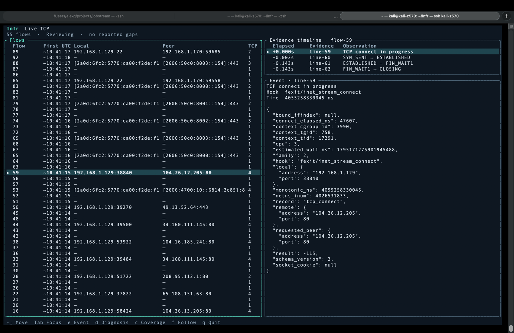

# lnfr

**See what Linux observed when a TCP connection worked, failed, or stalled.**

lnfr (Linux Network Flight Recorder) is a read-only eBPF tool for diagnosing
IPv4 and IPv6 TCP connections. Watch flows in the terminal as they happen, or
save a JSONL capture and inspect the evidence after the incident.



## What you can find out

| Question | What lnfr shows |
| --- | --- |
| Did the connection establish? | Local and peer endpoints, TCP state transitions such as `SYN_SENT → ESTABLISHED`, and successful kernel accepts when the hook is available. |
| Was the connection refused or did it time out? | The kernel's connect result, including `ECONNREFUSED` and `ETIMEDOUT` when observed, with the original event behind the diagnosis. |
| Did TCP retry? | Retransmit observations in the flow timeline. |
| What did Linux do with the traffic? | Optional TCP NAT translations, TCP observations at interface ingress and egress, software bridge port selection, and IP forwarding interface selection. |

In a replay of a closed-port veth test, `lnfr explain` reported a confirmed
`connection_refused` diagnosis. It cited `line-2`, the event where the kernel
returned `ECONNREFUSED`. The source of the refusal remained unknown.
[See the fixture and its output.](docs/TEST_PLAN.md#phase-3-flow-and-diagnosis-verification)

lnfr reports which probes were active, which were unavailable, and where
events were lost or rate-limited. A missing event leaves the outcome unknown.
A retransmit alone gives no location or cause of loss. lnfr records metadata
and leaves traffic untouched.

## Try it live

On x86-64 Linux, build from the repository root and check which probes the
host exposes. See the [build requirements](docs/USER_GUIDE.md#build-and-check-your-host)
for the toolchain and kernel prerequisites.

```bash
cargo build --locked
target/debug/lnfr doctor
sudo -v
target/debug/lnfr tui --live
```

Run the last two commands in the same terminal. The viewer runs as your normal
user and starts the collector with sudo. From a second terminal, use Python 3
to make a blocking connection attempt to an unused localhost port.

```bash
python3 -c 'import socket; socket.create_connection(("127.0.0.1", 1))'
```

If nothing listens on port 1, Python reports `ConnectionRefusedError` and lnfr
can show the kernel's `ECONNREFUSED` result when the connect probe is active.

Use **↑/↓** to select a flow or event, **Tab** to switch panes, **d** for the
diagnosis, **c** for capture coverage, and **q** to quit.

## Save a capture for later

```bash
sudo target/debug/lnfr capture --duration 10s > session.jsonl
target/debug/lnfr tui --input session.jsonl
```

Reproduce the issue while the capture is running. You can also use `lnfr flows`
to list flow IDs and `lnfr explain` to get a timeline and its supporting events
as JSON. Reviewing a saved capture requires no elevated privileges.

## Documentation

- [User guide](docs/USER_GUIDE.md) — build requirements, capture filters, optional probes, and troubleshooting.
- [Architecture](docs/ARCHITECTURE.md) — kernel hooks, event ordering, and correlation rules.
- [Verification](docs/TEST_PLAN.md) — reproducible network namespace fixtures and recorded results.
- [Contributing](docs/REMOTE_DEV.md) — development environment and local checks.
- [Roadmap](docs/ROADMAP.md) — what works today and what's planned.
